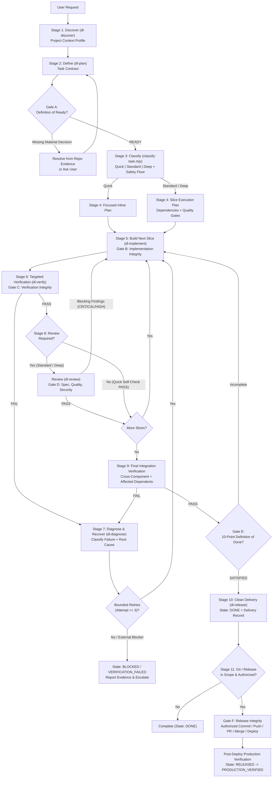

# Phase 2 — DevLifecycle v2.1 Architecture, P13 Context Intelligence & Design Rationale

---

## 1. Architectural Goals & Design Rationale

**DevLifecycle v2.1 (`dev-lifecycle`)** is designed around five core engineering constraints:

1. **Zero Framework Lock-In**: Projects range from polyglot monorepos (Turborepo, Nx, pnpm, Cargo, Go workspaces) to custom/unknown frameworks (e.g., Void) and bare Makefile repositories. Discovery relies on multi-signal evidence and confidence scoring rather than hardcoded stack templates.
2. **Proportional Overhead**: Running a 7-agent swarm and generating 6 Markdown files for a 2-line bug fix wastes tokens and developer time. Conversely, allowing a 3-line authentication or database migration change to skip security review is dangerous. DevLifecycle solves this with an **8-Factor Risk Classifier** and a **High-Risk Safety Floor**.
3. **Persistent Project Context Intelligence (`P13 — Context Freshness & Integrity`)**: Re-scanning an entire repository on every task or session wastes time, while blindly trusting stale cached context causes broken builds. DevLifecycle v2.1 partitions project knowledge into **10 independent `contextSections`** backed by SHA-256 file evidence and Git state fingerprints, refreshing only the sections invalidated by actual repository changes while always inspecting task-specific source files in their live state.
4. **Progressive Context Disclosure**: All persistent rules fit in a compact `rules/AGENTS.md` (<8 KB), each of the 8 skills (`dl-run`, `dl-discover`, `dl-plan`, `dl-implement`, `dl-verify`, `dl-review`, `dl-release`, `dl-diagnose`) is under 9 KB, and deep reference tables live in `references/` where they are read only when needed.
5. **Deterministic Guardrails Without Heavy Loops**: Rather than running slow linters after every file edit via hooks, `hooks.json` uses fast (<50ms) Node.js scripts (`session-start-context.mjs`, `pre-tool-safety.mjs`, `post-tool-tracker.mjs`, `stop-gate.mjs`) to check cached context availability, block destructive commands, enforce human approval on release/production operations, record dirty context hints, count bounded repair retries, and detect redundant check executions.

---

## 2. P13 Context Persistence, Freshness & Incremental Rediscovery Architecture

### A. Project Identity & Isolation (`scripts/context-store.mjs`)
- **`projectId` (`dl-proj-<worktreeKey>`)**: Derived from `canonicalRoot` + `gitDir` (`git rev-parse --git-dir`), guaranteeing that multiple Git worktrees (`git worktree add`) or separate clones never overwrite or contaminate each other's uncommitted state.
- **`commonRepoKey` (`projectKey`)**: Derived from `gitCommonDir` (`git rev-parse --git-common-dir`) + `rootCommit`, linking worktrees that share a repository lineage.
- **`lineageFingerprint`**: Enables safe relocation detection when a repository folder is moved or renamed on disk.

### B. Storage Tier Hierarchy & Graceful Fallback
1. **`plugin-data`**: Uses `${PLUGIN_DATA}/context-cache` when injected by Antigravity into hook subprocesses (and mirrors to the OS user cache directory so standalone CLI calls share the same cache).
2. **`os-user-cache`**: Conventional OS-level user cache (`%LOCALAPPDATA%\dev-lifecycle\Cache\u-<hash>\context-v2.1` on Windows, `~/Library/Caches/dev-lifecycle` on macOS, `~/.cache/dev-lifecycle` on Linux) via standard Node.js `fs` APIs when `${PLUGIN_DATA}` is not set in standalone `run_command` shells.
3. **`session-fallback`**: Uses `<artifactDirectoryPath>/scratch/context-cache` when persistent user directories are restricted.
4. **`memory-only`**: Uses an in-process `Map` when all disk locations are unwritable, honestly reporting `persisted: false`.

### C. Granular 10-Section Invalidation Matrix (`scripts/context-freshness.mjs`)

| Change Signal Detected | Invalidated Sections Recomputed | Preserved Sections Reused |
| :--- | :--- | :--- |
| **Unchanged Repo (`FRESH`)** | None (`0/10`) | All 10 sections (`10/10`) |
| **Single Source File Edit (`src/foo.ts`)** | `impactAnalysis` + live `taskSpecificFiles` (`0/10` project sections) | All 10 project-level sections (`10/10`) |
| **Root Manifest (`package.json`, `Cargo.toml`)** | `topology`, `languages`, `frameworks`, `packageManagers`, `workspacePackages`, `dependencyGraph`, `verificationCommands` | `projectInstructions`, `ciCd`, `deployment` |
| **Subpackage Manifest (`packages/*/package.json`)** | `languages`, `frameworks`, `packageManagers`, `workspacePackages`, `dependencyGraph`, `verificationCommands` | `topology`, `projectInstructions`, `ciCd`, `deployment` |
| **Lockfile (`pnpm-lock.yaml`, `package-lock.json`)** | `packageManagers`, `frameworks`, `dependencyGraph` | `topology`, `languages`, `workspacePackages`, `verificationCommands`, `projectInstructions`, `ciCd`, `deployment` |
| **CI Workflow (`.github/workflows/*.yml`)** | `ciCd` | All other 9 sections (`9/10`) |
| **Deployment Config (`Dockerfile`, `wrangler.toml`)** | `deployment` | All other 9 sections (`9/10`) |
| **Instructions (`AGENTS.md`, `README.md`)** | `projectInstructions` | All other 9 sections (`9/10`) |
| **Corrupted JSON / Schema Mismatch** | Full Rediscovery (`10/10`) + Atomic Cache Repair | None |

---

## 2. Adaptive Lifecycle State Model

---

## 3. Component Interaction Matrix

| Lifecycle Stage | Active Skill | Supporting Script | Subagent Role (When Justified) | Output / Gate Artifact |
| :--- | :--- | :--- | :--- | :--- |
| **1. Discover** | `dl-discover` | `scripts/discover-project.mjs` | `software-architect` (Deep mode) | `Project Context Profile` |
| **2. Define** | `dl-plan` | `scripts/lifecycle-check.mjs` | `lifecycle-orchestrator` | `Task Contract` (`Gate A`) |
| **3. Classify** | `dl-plan` | `scripts/classify-task.mjs` | — | Execution Profile (`Quick`/`Standard`/`Deep`) |
| **4. Plan** | `dl-plan` | — | `software-architect` (Deep mode) | `Execution Plan` (`implementation_plan.md`) |
| **5. Build** | `dl-implement` | `scripts/pre-tool-safety.mjs` | `implementation-engineer` | Minimal Scoped Diff (`Gate B`) |
| **6. Verify** | `dl-verify` | `scripts/post-tool-tracker.mjs` | `quality-engineer` | `Verification Evidence` (`Gate C`) |
| **7. Diagnose** | `dl-diagnose` | `scripts/classify-task.mjs` | `quality-engineer` | Root-Cause Fix or Escalation (`BLOCKED`) |
| **8. Review** | `dl-review` | — | `code-reviewer`, `security-reviewer` | `Review Findings` (`Gate D`) |
| **9. Integrate** | `dl-verify` | `scripts/discover-project.mjs` | `quality-engineer` | Integrated Verification Evidence |
| **10. Deliver** | `dl-release` | `scripts/lifecycle-check.mjs` | `release-engineer` | `Delivery Record` (`Gate E`, `DONE`) |
| **11. Release** | `dl-release` | `scripts/pre-tool-safety.mjs` | `release-engineer` | Release & Prod Evidence (`Gate F`) |
