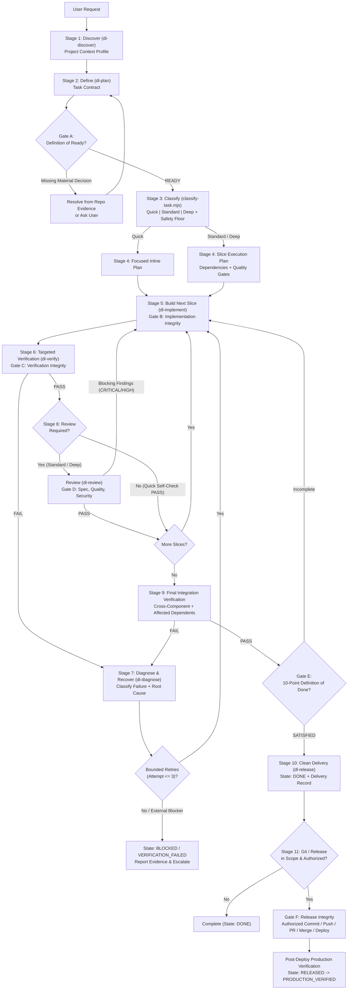

# Phase 2 — DevLifecycle v2 Architecture & Design Rationale

---

## 1. Architectural Goals & Design Rationale

**DevLifecycle v2 (`dev-lifecycle`)** is designed around four engineering constraints:

1. **Zero Framework Lock-In**: Projects range from polyglot monorepos (Turborepo, Nx, pnpm, Cargo, Go workspaces) to custom/unknown frameworks (e.g., Void) and bare Makefile repositories. Discovery relies on multi-signal evidence and confidence scoring rather than hardcoded stack templates.
2. **Proportional Overhead**: Running a 7-agent swarm and generating 6 Markdown files for a 2-line bug fix wastes tokens and developer time. Conversely, allowing a 3-line authentication or database migration change to skip security review is dangerous. DevLifecycle solves this with an **8-Factor Risk Classifier** and a **High-Risk Safety Floor**.
3. **Progressive Context Disclosure**: All persistent rules fit in a compact `rules/AGENTS.md` (<7 KB), each of the 8 skills (`dl-run`, `dl-discover`, `dl-plan`, `dl-implement`, `dl-verify`, `dl-review`, `dl-release`, `dl-diagnose`) is under 9 KB, and deep reference tables live in `references/` where they are read only when needed.
4. **Deterministic Guardrails Without Heavy Loops**: Rather than running slow linters after every file edit via hooks, `hooks.json` uses fast (<50ms) Node.js scripts (`pre-tool-safety.mjs`, `post-tool-tracker.mjs`, `stop-gate.mjs`) to block destructive commands, enforce human approval on release/production operations, count bounded repair retries, and detect redundant check executions.

---

## 2. Adaptive Lifecycle State Model

---

## 3. Component Interaction Matrix

| Lifecycle Stage | Active Skill | Supporting Script | Subagent Role (When Justified) | Output / Gate Artifact |
| :--- | :--- | :--- | :--- | :--- |
| **1. Discover** | `dl-discover` | `scripts/discover-project.mjs` | `software-architect` (Deep mode) | `Project Context Profile` |
| **2. Define** | `dl-plan` | `scripts/lifecycle-check.mjs` | `lifecycle-orchestrator` | `Task Contract` (`Gate A`) |
| **3. Classify** | `dl-plan` | `scripts/classify-task.mjs` | — | Execution Profile (`Quick`/`Standard`/`Deep`) |
| **4. Plan** | `dl-plan` | — | `software-architect` (Deep mode) | `Execution Plan` (`implementation_plan.md`) |
| **5. Build** | `dl-implement` | `scripts/pre-tool-safety.mjs` | `implementation-engineer` | Minimal Scoped Diff (`Gate B`) |
| **6. Verify** | `dl-verify` | `scripts/post-tool-tracker.mjs` | `quality-engineer` | `Verification Evidence` (`Gate C`) |
| **7. Diagnose** | `dl-diagnose` | `scripts/classify-task.mjs` | `quality-engineer` | Root-Cause Fix or Escalation (`BLOCKED`) |
| **8. Review** | `dl-review` | — | `code-reviewer`, `security-reviewer` | `Review Findings` (`Gate D`) |
| **9. Integrate** | `dl-verify` | `scripts/discover-project.mjs` | `quality-engineer` | Integrated Verification Evidence |
| **10. Deliver** | `dl-release` | `scripts/lifecycle-check.mjs` | `release-engineer` | `Delivery Record` (`Gate E`, `DONE`) |
| **11. Release** | `dl-release` | `scripts/pre-tool-safety.mjs` | `release-engineer` | Release & Prod Evidence (`Gate F`) |
